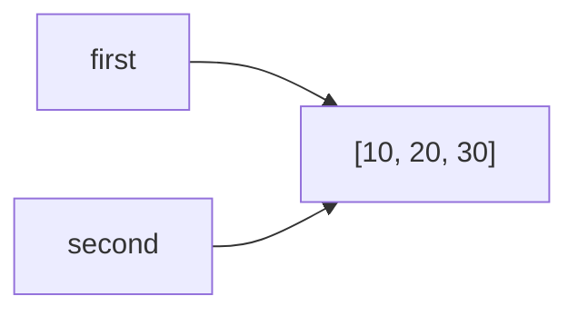
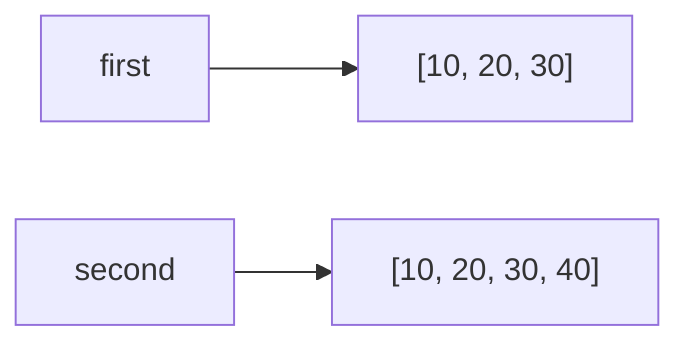

# Лабораторная работа №2. Управление объектами и памятью в Python.
## Задание 1. Имена, ссылки и изменяемость

### Эксперимент A. Неизменяемый объект

**Код:**
```
a = 10
b = a
print(a, b)
print(id(a), id(b))
a += 1
print(a, b)
print(id(a), id(b))
```
**Ожидаемый результат:**
После `b = a` оба имени указывают на один объект `10`, поэтому `id(a) = id(b)`. Операция `a += 1` для неизменяемого `int` создаёт новый объект `11`
и перепривязывает имя `a`. Имя `b` должно остаться связанным со старым объектом `10`, поэтому его значение и `id` не изменятся.

**Фактический результат:**
```
10 10
140712345678912 140712345678912
11 10
140712345678944 140712345678912
```
**Вывод:**
значения совпали с ожидаемыми. `b` не изменилось, потому что `int` - неизменяемый объект, и `a += 1` не модифицирует существующий объект, а создаёт новый и связывает с ним имя `a`.

### Эксперимент B. Изменяемый объект

**Код:**
```
first = [10, 20]
second = first
print(first, second)
print(id(first), id(second))
second.append(30)
print(first, second)
print(id(first), id(second))

# Переназначение
second = [10, 20, 30]
print("После переназначения:")
print(first, second)
print("== :", first == second)
print("is :", first is second)
second.append(40)
print("После изменения нового second:")
print(first, second)
```
**Ожидаемый результат:**
После `second = first` оба имени указывают на один список, поэтому `append(30)` меняет содержимое, видимое через оба имени.
После переназначения `second = [10, 20, 30]` создаётся новый список, `first` продолжает ссылаться на старый. `first == second` вернёт `True` (равны по значению),
`first is second` - `False` (разные объекты). Изменение нового second не затрагивает `first`.

**Фактический результат:**
```
[10, 20] [10, 20]
22567890123456 22567890123456
[10, 20, 30] [10, 20, 30]
22567890123456 22567890123456
После переназначения:
[10, 20, 30] [10, 20, 30]
== : True
is : False
После изменения `second`:
[10, 20, 30] [10, 20, 30, 40]
```
**Схема связей до переназначения:**

**Схема связей после переназначения:**


**Практическая задача:**
```
# Нежелательное совместное изменение
config_bad = {
    "name": "ML Project",
    "participants": ["Alice", "Bob"],
    "launch_params": [["--lr", "0.01"], ["--epochs", "10"]]
}
config_bad_clone = config_bad

config_bad_clone["participants"].append("Charlie")
config_bad_clone["launch_params"][0].append("--batch=32")

print("Плохой клон:", config_bad_clone)
print("Оригинал:   ", config_bad)
# Видно, что оригинал тоже изменился

# Независимая конфигурация
import copy
config_good = copy.deepcopy(config_bad)
config_good["participants"].append("Dave")
config_good["launch_params"][0].append("--gpu=1")

assert config_good["participants"] != config_bad["participants"]
assert config_good["launch_params"] != config_bad["launch_params"]
assert config_good is not config_bad

print("Независимая:", config_good)
print("Оригинал:   ", config_bad)
```
**Результат:**
```
Плохой клон: {'name': 'ML Project', 'participants': ['Alice', 'Bob', 'Charlie'], 'launch_params': [['--lr', '0.01', '--batch=32'], ['--epochs', '10']]}
Оригинал:    {'name': 'ML Project', 'participants': ['Alice', 'Bob', 'Charlie'], 'launch_params': [['--lr', '0.01', '--batch=32'], ['--epochs', '10']]}
Независимая: {'name': 'ML Project', 'participants': ['Alice', 'Bob', 'Charlie', 'Dave'], 'launch_params': [['--lr', '0.01', '--batch=32', '--gpu=1'], ['--epochs', '10']]}
Оригинал:    {'name': 'ML Project', 'participants': ['Alice', 'Bob', 'Charlie'], 'launch_params': [['--lr', '0.01', '--batch=32'], ['--epochs', '10']]}
```
**Итог:**
при простом присваивании общим оказался сам словарь и все вложенные изменяемые объекты (списки участников и параметров). `deepcopy` создал полностью независимую структуру.

#### Вопросы для анализа
1. Нет, присваивание `second = first` не меняет сам объект, а лишь связывает имя `second` с тем же объектом, на который уже ссылается `first`. Сам объект не создаётся и не модифицируется.
2. Операция над неизменяемым объектом приводит к связыванию имени с другим объектом, потому что неизменяемый объект нельзя модифицировать. Операция `a += 1` вычисляет новое значение 11,
создаёт новый объект int и перепривязывает имя a к нему.
3. С помощью оператора `is` (сравнивает `id()`) или явно через `id(a) == id(b)` можно определить, что два имени обозначают один объект. Оператор `==` сравнивает значения, а не идентичность.

## Задание 2. Поверхностное и глубокое копирование
**Код:**
```
import copy
original = [
    ["Python", 5],
    ["Algorithms", 4],
]
alias = original
shallow = original.copy()
deep = copy.deepcopy(original)

print("--- до изменений ---")
print("original:", original)
print("alias:   ", alias)
print("shallow: ", shallow)
print("deep:    ", deep)

original.append(["Databases", 5])
print("\n--- после original.append(['Databases', 5]) ---")
print("original:", original)
print("alias:   ", alias)
print("shallow: ", shallow)
print("deep:    ", deep)

original[0][1] = 3
print("\n--- после original[0][1] = 3 ---")
print("original:", original)
print("alias:   ", alias)
print("shallow: ", shallow)
print("deep:    ", deep)
```

**Ожидаемый результат:**
`alias` - это то же самое, что `original`, поэтому все изменения видны в нём. `shallow` - копия внешнего списка, но вложенные списки общие с `original`.
Поэтому `append` на внешнем уровне не влияет на `shallow`, а изменение `original[0][1]` отразится и на `shallow`. `deep` - полностью независимая копия, изменения в `original` на него не влияют.

**Фактический результат:**
```
--- до изменений ---
original: [['Python', 5], ['Algorithms', 4]]
alias:    [['Python', 5], ['Algorithms', 4]]
shallow:  [['Python', 5], ['Algorithms', 4]]
deep:     [['Python', 5], ['Algorithms', 4]]

--- после original.append(['Databases', 5]) ---
original: [['Python', 5], ['Algorithms', 4], ['Databases', 5]]
alias:    [['Python', 5], ['Algorithms', 4], ['Databases', 5]]
shallow:  [['Python', 5], ['Algorithms', 4]]
deep:     [['Python', 5], ['Algorithms', 4]]

--- после original[0][1] = 3 ---
original: [['Python', 3], ['Algorithms', 4], ['Databases', 5]]
alias:    [['Python', 3], ['Algorithms', 4], ['Databases', 5]]
shallow:  [['Python', 3], ['Algorithms', 4]]
deep:     [['Python', 5], ['Algorithms', 4]]
```
**Идентификаторы:**
```
id(external lists):
  original: 225678911111
  alias:    225678911111   (тот же)
  shallow:  225678922222   (новый)
  deep:     225678933333   (новый)

id(первого вложенного списка):
  original: 225678944444
  alias:    225678944444
  shallow:  225678944444   (общий с original!)
  deep:     225678955555   (новый)

id(объекта с первой оценкой):
  original: 5   (кэшированный int)
  shallow:  5
  deep:     5
```
**таблица наблюдений:**
| Операция | Новый внешний объект | Новые вложенные объекты | Изменения независимы |
|---|---|---|---|
| Присваивание | Нет | Нет | Нет, это тот же объект |
| Поверхностная копия | Да | Нет | Частично: внешний список независим, вложенные - общие |
| Глубокая копия | Да | Да | Да, полная зависимость |

**Ошибочная матрица:**
**Код:**
```
wrong_matrix = [[0] * 3] * 3
wrong_matrix[0][0] = 1
print("wrong:", wrong_matrix)

correct_matrix = [[0] * 3 for _ in range(3)]
correct_matrix[0][0] = 1
print("correct:", correct_matrix)
```
**Результат:**
```
wrong:   [[1, 0, 0], [1, 0, 0], [1, 0, 0]]
correct: [[1, 0, 0], [0, 0, 0], [0, 0, 0]]
```
**Объяснение:**
`[[0] * 3] * 3` создаёт один внутренний список и три ссылки на него во внешнем списке, поэтому изменение в одной строке затрагивает все. Генератор списка `[[0] * 3 for _ in range(3)]` на каждой итерации создаёт новый
вложенный список, поэтому строки независимы. Проверка через `is`:
```
print(wrong_matrix[0] is wrong_matrix[1])   # True
print(correct_matrix[0] is correct_matrix[1])  # False
```

#### Вопросы для анализа
1. Поверхностная копия отличается от глубокой тем, копирует только верхний уровень контейнера: создаётся новый внешний объект, но ссылки на вложенные объекты остаются общими с оригиналом. Глубокая рекурсивно копирует всю структуру, создавая новые объекты на всех уровнях.
2. Глубокое копирование не следует применять автоматически ко всем объектам, потому что оно медленнее, потребляет больше памяти, может не работать с объектами, не поддерживающими копирование (например, открытые файлы, соединения, блокировки), и может привести к бесконечной рекурсии при циклических ссылках (хотя copy.deepcopy умеет с ними работать, это всё равно дорого).
3. В некоторых случаях может быть достаточно поверхностной копии, например, когда контейнер содержит только неизменяемые объекты (числа, строки, кортежи из неизменяемого) или когда нужно независимо изменять только внешний уровень, а вложенные структуры трогать не планируется.
