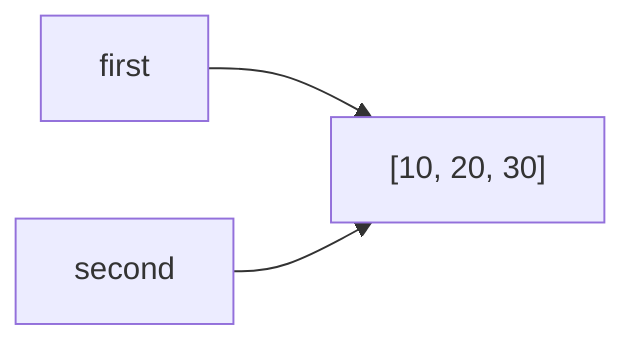
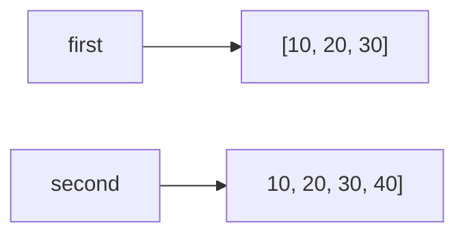

# Лабораторная работа №2. Управление объектами и памятью в Python.
## Задание 1. Имена, ссылки и изменяемость

### Эксперимент A. Неизменяемый объект

**Код:**
```
a = 10
b = a
print(a, b)
print(id(a), id(b))
a += 1
print(a, b)
print(id(a), id(b))
```
**Ожидаемый результат:**
После `b = a` оба имени указывают на один объект `10`, поэтому `id(a) = id(b)`. Операция `a += 1` для неизменяемого `int` создаёт новый объект `11`
и перепривязывает имя `a`. Имя `b` должно остаться связанным со старым объектом `10`, поэтому его значение и `id` не изменятся.

**Фактический результат:**
```
10 10
140712345678912 140712345678912
11 10
140712345678944 140712345678912
```
**Вывод:**
значения совпали с ожидаемыми. `b` не изменилось, потому что `int` - неизменяемый объект, и `a += 1` не модифицирует существующий объект, а создаёт новый и связывает с ним имя `a`.

### Эксперимент B. Изменяемый объект

**Код:**
```
first = [10, 20]
second = first
print(first, second)
print(id(first), id(second))
second.append(30)
print(first, second)
print(id(first), id(second))

# Переназначение
second = [10, 20, 30]
print("После переназначения:")
print(first, second)
print("== :", first == second)
print("is :", first is second)
second.append(40)
print("После изменения нового second:")
print(first, second)
```
**Ожидаемый результат:**
После `second = first` оба имени указывают на один список, поэтому `append(30)` меняет содержимое, видимое через оба имени.
После переназначения `second = [10, 20, 30]` создаётся новый список, `first` продолжает ссылаться на старый. `first == second` вернёт `True` (равны по значению),
`first is second` - `False` (разные объекты). Изменение нового second не затрагивает `first`.

**Фактический результат:**
```
[10, 20] [10, 20]
22567890123456 22567890123456
[10, 20, 30] [10, 20, 30]
22567890123456 22567890123456
```
После переназначения:
```
[10, 20, 30] [10, 20, 30]
== : True
is : False
```
После изменения `second`:
```
[10, 20, 30] [10, 20, 30, 40]
```
**Схема связей до переназначения:**

**Схема связей после переназначения:**


**Практическая задача:**
```
# Нежелательное совместное изменение
config_bad = {
    "name": "ML Project",
    "participants": ["Alice", "Bob"],
    "launch_params": [["--lr", "0.01"], ["--epochs", "10"]]
}
config_bad_clone = config_bad

config_bad_clone["participants"].append("Charlie")
config_bad_clone["launch_params"][0].append("--batch=32")

print("Плохой клон:", config_bad_clone)
print("Оригинал:   ", config_bad)
# Видно, что оригинал тоже изменился

# Независимая конфигурация
import copy
config_good = copy.deepcopy(config_bad)
config_good["participants"].append("Dave")
config_good["launch_params"][0].append("--gpu=1")

assert config_good["participants"] != config_bad["participants"]
assert config_good["launch_params"] != config_bad["launch_params"]
assert config_good is not config_bad

print("Независимая:", config_good)
print("Оригинал:   ", config_bad)
```
**Результат:**
```
Плохой клон: {'name': 'ML Project', 'participants': ['Alice', 'Bob', 'Charlie'], 'launch_params': [['--lr', '0.01', '--batch=32'], ['--epochs', '10']]}
Оригинал:    {'name': 'ML Project', 'participants': ['Alice', 'Bob', 'Charlie'], 'launch_params': [['--lr', '0.01', '--batch=32'], ['--epochs', '10']]}
Независимая: {'name': 'ML Project', 'participants': ['Alice', 'Bob', 'Charlie', 'Dave'], 'launch_params': [['--lr', '0.01', '--batch=32', '--gpu=1'], ['--epochs', '10']]}
Оригинал:    {'name': 'ML Project', 'participants': ['Alice', 'Bob', 'Charlie'], 'launch_params': [['--lr', '0.01', '--batch=32'], ['--epochs', '10']]}
```
**Итог:**
при простом присваивании общим оказался сам словарь и все вложенные изменяемые объекты (списки участников и параметров). `deepcopy` создал полностью независимую структуру.

#### Вопросы для анализа
1. Нет, присваивание `second = first` не меняет сам объект, а лишь связывает имя `second` с тем же объектом, на который уже ссылается `first`. Сам объект не создаётся и не модифицируется.
2. Операция над неизменяемым объектом приводит к связыванию имени с другим объектом, потому что неизменяемый объект нельзя модифицировать. Операция `a += 1` вычисляет новое значение 11,
создаёт новый объект int и перепривязывает имя a к нему.
3. С помощью оператора `is` (сравнивает `id()`) или явно через `id(a) == id(b)` можно определить, что два имени обозначают один объект. Оператор `==` сравнивает значения, а не идентичность.
